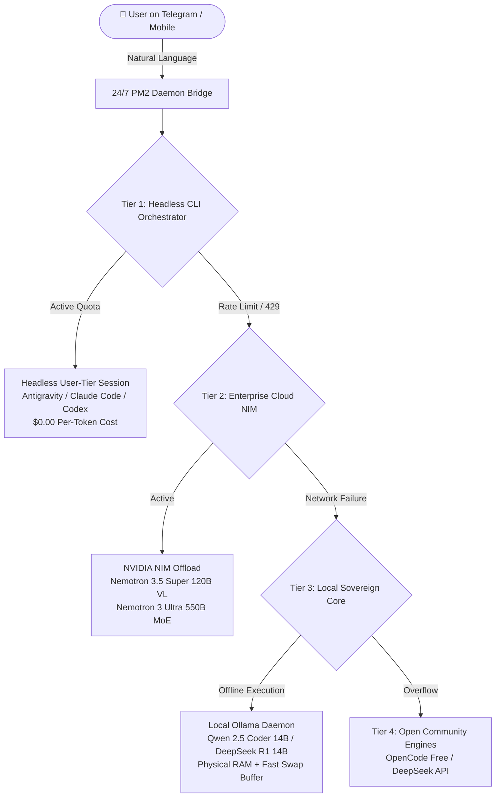

# 🌌 Infinite AI Mesh: Sovereign 24/7 Multi-Engine Architecture

[](https://opensource.org/licenses/MIT)
[]()
[]()

A production-grade Agent Skill and architectural blueprint for running a **24/7 sovereign, zero-per-token AI mesh** on personal cloud instances (e.g., Oracle Cloud Always Free, homelab, VPS).

---

## ⚡ The Problem: The "API Bleed" & "Single Point of Failure"

Standard autonomous AI agents typically rely on a single pay-per-token commercial API key:
1. **Financial Runaway**: Autonomous tasks looping over refactoring, test suites, and databases can consume tens of dollars in minutes.
2. **Hard Outages**: When the provider experiences a rate-limit (HTTP 429), capacity degradation, or billing expiration, the agent completely halts.
3. **Mobile Disconnect**: Users on mobile devices have no bash shell to unblock agents or run terminal commands.

---

## 🛡️ The Solution: The 4-Tier Infinite AI Mesh



### The 4 Tiers

| Tier | Engine | How It Works | Cost Model |
| :--- | :--- | :--- | :--- |
| **Tier 1: Sovereign Headless** | Google Antigravity / Claude Code | Headless CLI driven by persistent OAuth token (`antigravity-oauth-token`). Full file & shell tool rights. | **$0.00** per token (included in user subscription) |
| **Tier 2: Enterprise NIM Offload** | NVIDIA Nemotron 3.5 Super (120B) / 3 Ultra (550B) | Direct REST queries to NVIDIA NIM inference endpoints for deep Chain-of-Thought reasoning. | **Free** developer tier |
| **Tier 3: Local Sovereign Core** | Ollama (`qwen2.5-coder:14b`) | 100% offline, running on server CPU/RAM with Linux swap optimization (`vm.swappiness=10`). | **$0.00** (Private, offline) |
| **Tier 4: Resilient Fallback** | OpenCode Community / DeepSeek | Secondary community inference endpoints for fail-safe continuity. | **$0.00** / Community |

---

## 🧠 The Hardware "Golden Ratio" Formula

Running large models on CPU without GPUs requires calculating the **Memory Sweet-Spot**:

$$\text{Model Weight (14B Q4)} \approx 9.0\text{ GB} \le \text{Available Physical RAM (14--16 GB)}$$

* **Why 14B is the golden limit**: A 14B model fits 100% into physical RAM, reading memory at ~40 GB/s on DDR4/DDR5.
* **Why 32B fails on CPU without GPU**: A 32B model (~20 GB) spills over into Swap (disk). Disk throughput (~500 MB/s) is 80x slower, causing latency to plummet from 4 seconds to 15 minutes per response.
* **The Linux Swap Buffer**: Adding 8 GB Swap guarantees the Linux Out-Of-Memory (OOM) killer never terminates essential background services.

---

## 🚀 Quick Setup & Installation

### 1. Optimize Memory and Install Local Core
Run the included optimization script to configure Linux swap and pull the 14B model:
```bash
bash templates/setup-swap-and-ollama.sh
```

### 2. Configure NVIDIA NIM Offloading
Add your NVIDIA API key to your environment:
```bash
export NVIDIA_API_KEY="nvapi-your-key-here"
python3 templates/nvidia_delegate.py.example "Analyze this logic puzzle"
```

### 3. Deploy the 24/7 Mobile Chat Daemon
Copy and adjust the bridge configuration:
```bash
pm2 start templates/ecosystem.config.js.example
pm2 save
```

---

## 🔒 Security & Privacy Hardening

1. **Zero Secret Leaks**: All configuration templates use placeholders (`<YOUR_TOKEN>`). Never commit private keys, IP addresses, or internal paths.
2. **File Permissions**: OAuth session tokens and private keys must be secured with:
   ```bash
   chmod 600 ~/.gemini/antigravity-cli/*-token
   chmod 600 ~/.ssh/id_*
   ```
3. **Allowlist Guard**: The mobile bridge should restrict execution strictly to verified user chat IDs.

---

## 📄 License

MIT License. Designed and architected for the sovereign open-source AI community.
