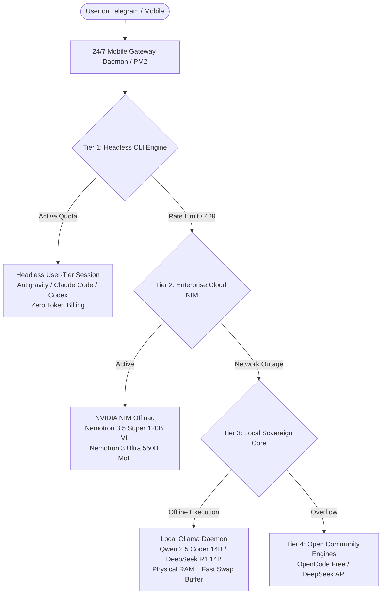

# Infinite AI Mesh: Sovereign 24/7 Multi-Engine Architecture

This skill equips any AI agent or platform engineer with the architecture, operational runbooks, and configurations needed to deploy an **uninterrupted, zero-per-token AI mesh** on personal or private cloud instances (e.g., Oracle Cloud Free Tier, bare metal, homelab).

---

## 🏗️ Core Architectural Philosophy

Traditional AI agent deployments suffer from two fatal vulnerabilities:
1. **API Cost Bleed**: Per-token API keys quickly accumulate exorbitant costs during autonomous looping, file editing, or continuous monitoring.
2. **Hard Rate-Limit Blackouts**: When an API provider experiences downtime, 429 rate-limits, or billing hiccups, single-engine agents immediately die.

The **Infinite AI Mesh** resolves both challenges through a **4-tier cascading resilience topology**:

---

## ⚡ Tier Breakdown & Operational Roles

### 1. Tier 1 — The Headless User-Tier Orchestrator
* **Mechanism**: Leverages persistent OAuth token files (e.g., `antigravity-oauth-token`, Claude CLI user session) instead of pay-per-token API keys.
* **Cost**: $0.00 per generated token (billed exclusively through fixed user subscription / developer tier).
* **Execution Mode**: Spawns CLI processes with `--dangerously-skip-permissions` and continuous session flags (`-c`, `-p`).
* **Responsibility**: Primary orchestrator for tool usage, repository modification, git workflows, and system administration.

### 2. Tier 2 — Enterprise Cloud Offloading (NVIDIA NIM)
* **Mechanism**: Direct REST calls to NVIDIA NIM inference endpoints using developer access keys.
* **Selected Flagship Models**:
  - `nvidia/nemotron-3.5-super-vl-120b-a12b`: 120B Vision-Language model featuring **native Chain-of-Thought reasoning tokens** (`reasoning_content`) for architectural refactoring and visual evaluation.
  - `nvidia/nemotron-3-ultra-550b-a55b`: 550B Mixture of Experts (MoE) model for massive context synthesis.
* **Role**: Heavy-duty offloading for tasks that exceed local hardware capabilities without incurring commercial API bills.

### 3. Tier 3 — Local Sovereign Core (Ollama 14B on CPU)
* **Mechanism**: Local `ollama.service` running 24/7 on system RAM, optimized with dedicated fast NVMe Swap space.
* **The "Golden Ratio" Formula**:
  $$\text{Model Weight (14B Q4)} \approx 9.0\text{ GB} \le \text{Available Physical RAM (15 GB)}$$
* **Memory Budgeting Guardrail**:
  - Models $\le 14\text{B}$ fit 100% inside physical RAM, ensuring maximum memory bandwidth (~40 GB/s) on standard cloud vCPUs.
  - An additional 8 GB Swapfile provides kernel headroom, preventing the Linux Out-Of-Memory (OOM) killer from terminating database or background daemons.
* **Role**: Complete operational autonomy during total internet disconnects, private local database queries, and zero-cost batch processing.

### 4. Tier 4 — Open Resilient Community Fallback
* **Engines**: OpenCode CLI community providers, DeepSeek API (`deepseek-reasoner`).
* **Role**: Safety-net continuity layer when upstream cloud subscriptions reset or undergo maintenance.

---

## 📱 Mobile Chat Bridge Architecture

To allow zero-terminal users to interact effortlessly with this multi-tier mesh:

1. **Telegram Gateway Daemon**: A Node.js/TypeScript daemon running under PM2 (`pm2 start src/agy-bot.ts --name agy-telegram`).
2. **Child Process Execution**: Incoming chat prompts are queued sequentially per user, dynamically invoking the active tier CLI.
3. **Chunked Markdown Streaming**: Automatic pagination handles long markdown responses, code snippets, and Mermaid charts seamlessly within Telegram message boundaries.
4. **Autonomous Permissive Flagging**: Employs `--dangerously-skip-permissions` so the agent executes installations, diagnostic scripts, and repairs autonomously without demanding bash confirmations from mobile users.

---

## 🛡️ Security & Hardening Checklist

When deploying an Infinite AI Mesh:
- [ ] **Token Segregation**: Store OAuth credentials in mode `600` (`chmod 600 ~/.gemini/antigravity-cli/*-token`).
- [ ] **Sanitized Environment Variables**: Inject API keys exclusively through PM2 environment files or `/etc/environment`, never committed to git repositories.
- [ ] **Telegram User ID Allowlisting**: Hardcode the bot to respond ONLY to authorized Telegram `chat_id`s, rejecting unauthorized incoming traffic.
- [ ] **Memory Swap Tuning**: Set `vm.swappiness=10` to prioritize physical RAM for model weights while keeping the swap buffer as insurance.
